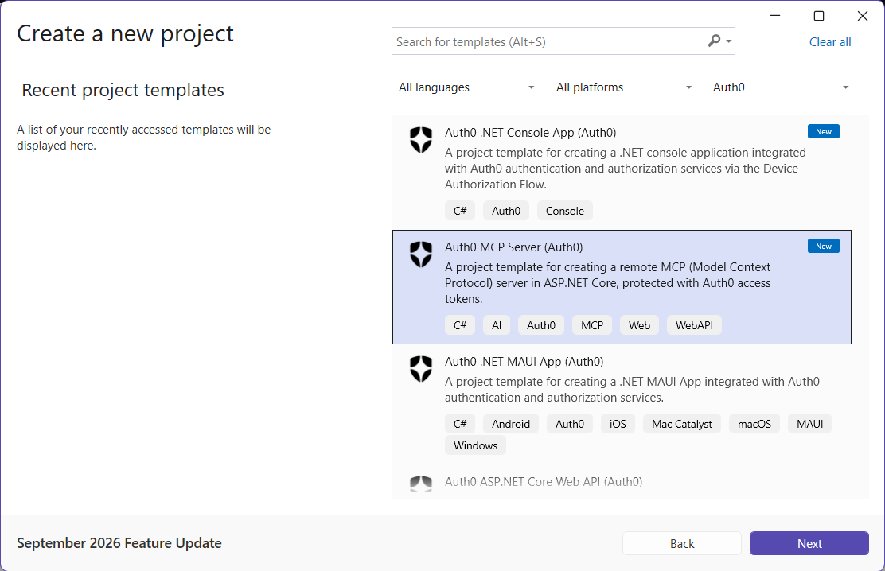
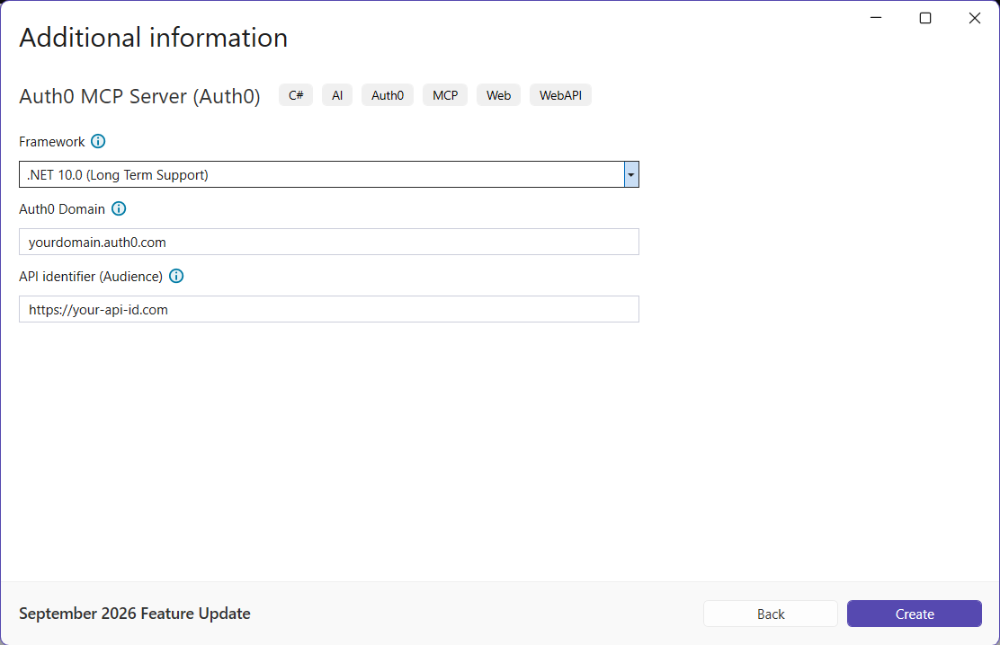

## Auth0 MCP Server Application

For more information about creating and securing an ASP.NET MCP server application with Auth0, check out the [Auth0 ASP.NET Web API Quickstart](https://auth0.com/docs/quickstart/backend/aspnet-core-webapi).

#### Using the .NET CLI

To create a new MCP server application, you can run the following command:

```
dotnet new auth0mcpserver [options]
```

This will create a new MCP server application with Auth0 support in the current folder.

##### Automatic registration

If you have the [Auth0 CLI](https://github.com/auth0/auth0-cli) installed on your machine and [logged in to Auth0](https://github.com/auth0/auth0-cli?tab=readme-ov-file#authenticating-to-your-tenant), you can run the template command without any options and it will automatically register and configure your application with Auth0.

Example:

```shell
dotnet new auth0mcpserver -o MyMcpServer
```

The template engine will ask for confirmation to perform the registration action:

```shell
The template "Auth0 MCP Server" was created successfully.

Processing post-creation actions...

Template is configured to run the following action:
Actual command: register-with-auth0.cmd 
Do you want to run this action [Y(yes)|N(no)]?
```

Once you confirm, you will get an entry for the application **in your current Auth0 tenant** and your application will be configured accordingly.

##### Manual registration

In addition to the usual options for the `dotnet new` command, the following template-specific options are available:

- `--domain`<br>
  The Auth0 domain associated with your tenant. The default value is `yourdomain.auth0.com`.
- `--audience`<br>
  The API identifier (audience) as defined in your Auth0 dashboard. It must be the URL of your MCP server (for example, `http://localhost:5000/`). The default value is `https://your-api-id.com`
- `-f` or `--framework`<br>
  Defines the target framework to use for the .NET project. The only supported value is `net10.0`.

Example:

```shell
dotnet new auth0mcpserver -o MyMcpServer --domain myapp.auth0.com --audience http://localhost:5000/
```

#### Completing the configuration

Your MCP server is registered with Auth0, but you still need to complete the configuration.

##### Complete your MCP server configuration

In your [Auth0 Dashboard](https://manage.auth0.com/#/apis):

- Set the *JWT Profile* to *RFC 9068*(see [here](https://auth0.com/docs/get-started/apis/configure-access-token-profile)).
- Enable *RBAC* and *Add Permissions in the Access Token*.
- Add the permissions `tool:getsystemstate` and `tool:setsystemstate`, and assign them to your users (see [here](https://auth0.com/docs/get-started/apis/enable-role-based-access-control-for-apis)).
- Set the user access policy in *Application Access* to *Allow* (see [here](https://auth0.com/docs/get-started/apis/api-access-policies-for-applications#configure-api-application-access-policy)).

##### Configure your Auth0 tenant

Enable the *Resource Parameter Compatibility Profile* (see [here](https://auth0.com/docs/get-started/tenant-settings#settings-advanced)) in [*Settings > Advanced*](https://manage.auth0.com/#/tenant/advanced) of your tenant, and choose how MCP clients register with Auth0:

- **Client ID Metadata Document (CIMD)**: the client ID is an HTTPS URL pointing to a metadata document published by the client. It is recommended for production because it is more secure and scalable. [Learn more about CIMD](https://auth0.com/docs/get-started/auth0-overview/create-applications/register-applications-with-cimd).
- **Dynamic Client Registration (DCR)**: clients register themselves at runtime. Enable it in [*Settings > Advanced*](https://manage.auth0.com/#/tenant/advanced) and [promote your connections to domain level](https://auth0.com/docs/authenticate/identity-providers/promote-connections-to-domain-level). It applies to the whole tenant and lets anyone create applications in it. [Learn more about DCR](https://auth0.com/docs/get-started/applications/dynamic-client-registration).

#### Testing the server

The `http` launch profile is the default one and listens on the HTTP port defined in `Properties/launchSettings.json`. It is intended for the development environment only: use HTTPS and a public URL as the API identifier outside development.

Run the application and add the server to your MCP client. For example, in Visual Studio Code, create a `.vscode/mcp.json` file:

```json
{
  "servers": {
    "my-mcp-server": {
      "type": "http",
      "url": "http://localhost:<port>/mcp"
    }
  }
}
```

#### Using Visual Studio for Windows

To create a new MCP server application with Visual Studio for Windows, select *Auth0* from the project types dropdown list and then *Auth0 MCP Server*:



Then, after inserting the name and the folder for the project, provide the required options:



#### Using JetBrains Rider

To create a new MCP server application with JetBrains Rider, select  *Auth0 MCP Server* from the *Custom Templates* list, expand the *Advanced Settings* section, and provide the required options.

##### Automatic registration

Unfortunately, Visual Studio and Rider do not support template's post actions (see [this issue](https://github.com/dotnet/templating/issues/4575) and [this one](https://github.com/dotnet/templating/issues/3226)) so your application will not be automatically registered as it happens with .NET CLI. However, you can run the post action manually to get your application configured.

To launch the automatic registration process, go to the folder of the newly created application and run the following command:

```shell
./register-with-auth0.cmd
```

> Note: on MacOS you need to enable the script to execute. Run the following command before launching the automatic registration:
>
> ```shell
> chmod +x register-with-auth0.cmd
> ```


---

[Back to README](../README.md)

